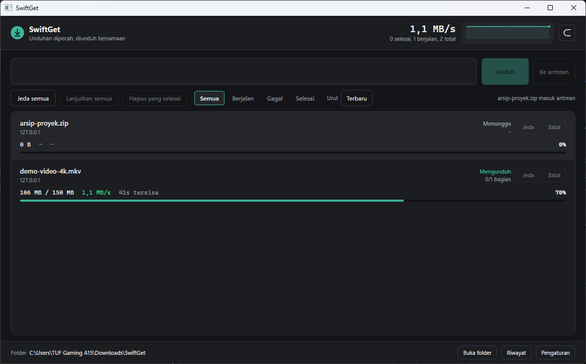

# SwiftGet

[](https://github.com/apissaj/SwiftGet/actions/workflows/ci.yml)


Pengelola unduhan untuk Windows: satu berkas dipencah menjadi beberapa bagian
yang diunduh bersamaan, disusun ulang saat berjalan, dan diverifikasi sebelum
dinyatakan selesai. Dibangun dengan WPF (.NET 8), tanpa dependensi runtime
selain .NET sendiri.



## Fitur

**Mesin unduhan**

- Unduhan segmented paralel dengan batas koneksi per unduhan dan per host.
- Dynamic segmentation: pekerja didistribusikan ulang saat berjalan — bagian
  terbesar dipecah saat ada koneksi menganggur, bagian kecil yang bersebelahan
  digabung, dan rentang yang gagal dikembalikan ke antrean.
- Resume setelah jeda, gagal, atau aplikasi ditutup; validator (ETag,
  Last-Modified, panjang konten) diperiksa ulang sebelum melanjutkan.
- Verifikasi checksum otomatis dari header respons: `Digest` (RFC 3230),
  `Content-MD5`, `X-Checksum-*`, dan `X-Goog-Hash` (SHA-256/384/512/1, MD5).
  Berkas yang tidak cocok dihapus, bukan dibiarkan.
- Unduhan HLS/DASH (`.m3u8`/`.mpd`): playlist diurai, kualitas terbaik
  dipilih, segmen diunduh paralel lalu digabung berurutan; DASH yang
  memisahkan video dan audio digabung lewat ffmpeg; playlist terenkripsi
  ditolak dengan pesan yang jelas.
- Fallback satu aliran untuk server yang tidak mendukung `Range`.

**Aplikasi**

- Daftar dengan penyaring status dan urutan (Terbaru, Status, Ukuran).
- Panel periksa: peta bagian, grafik kecepatan 30 detik, rincian koneksi dan
  validator; menjadi lapisan dengan perangkap fokus di jendela sempit.
- Riwayat unduhan selesai antar sesi dan kategori berkas otomatis.
- Pola kategori IDM: berkas selesai dipindah ke folder per kategori, bisa
  dimatikan di pengaturan; batas kecepatan total (speed limiter); HTTP
  Basic auth lewat URL berkredensial; daftar pengecualian tangkapan.
- Bookmarklet: endpoint lokal di `127.0.0.1` menerima URL dari browser
  (mati secara bawaan, dinyalakan di pengaturan).
- Deteksi URL dari clipboard, tray dengan aksi cepat, satu instance,
  tema terang/gelap yang mengikuti Windows dan bisa dipilih manual,
  menghormati preferensi "kurangi gerakan" secara langsung.

## Bangun dari sumber

Butuh .NET 8 SDK (Windows).

```powershell
dotnet build SwiftGet.sln -v q
dotnet test tests/SwiftGet.Tests/SwiftGet.Tests.csproj -v q
./build.ps1 -Target portable   # rilis: portable | framework-dependent | all
```

`build.ps1` menjalankan seluruh unit test lebih dulu; test yang gagal
membatalkan publish.

## Pakai sehari-hari

1. Tempel URL berkas di kotak atas, tekan Enter. Atau biarkan SwiftGet
   membaca clipboard: URL berkas yang disalin otomatis ditawarkan.
2. Berkas berjalan dalam beberapa bagian; jeda dan lanjutkan kapan saja —
   progres tersimpan di disk, bukan di memori.
3. Untuk unduhan dari browser: nyalakan "Terima unduhan dari bookmarklet
   browser" di pengaturan, buka `http://127.0.0.1:49160/`, lalu tarik tombol
   di halaman itu ke bookmark bar.

## Struktur repositori

```
src/SwiftGet.Core    Mesin unduhan: sesi, perencana segmen, klien HTTP,
                     parser playlist, penyimpanan manifest — tanpa UI.
src/SwiftGet.App     UI WPF: jendela utama, view model, tema, watcher sistem.
extension/           Ekstensi browser MV3 (Chrome/Edge, muat-unpacked).
tests                xUnit: parser, planner, integrasi HTTP, perilaku UI.
DESIGN.md            Otoritas desain: keputusan visual, interaksi, dan alasannya.
AGENTS.md            Petunjuk untuk agen coding yang bekerja di repo ini.
docs/                Catatan REA IDM (mesin dan ekstensi) + laporan delivery.
```

## Ekstensi browser (beta)

Ekstensi menambahkan panel **"Unduh video ini"** di atas elemen video,
gambar, dan audio di halaman mana pun — klik untuk mengirim ke SwiftGet
lengkap dengan cookie sesi dan referer halaman.

Selain DOM, ekstensi memindai respons `XHR`/`fetch` di dunia halaman
(mekanisme ala IDM): URL media yang tak pernah muncul di DOM — sumber dari
API situs streaming — terkumpul di **badge penghitung** pojok kanan bawah;
klik untuk memilih dan mengirim. Respons dibaca lewat clone dan dibatasi
ukuran, aplikasi tidak terganggu.

1. Salakan endpoint di SwiftGet: **Pengaturan → Integrasi browser**, catat
   port dan token yang tampil di sana.
2. Buka `chrome://extensions` (atau `edge://extensions`), aktifkan
   **Mode pengembang**, klik **Muat unpacked**, pilih folder `extension/`.
3. Buka opsi ekstensi, isi port dan token yang sama.
4. Arahkan kursor ke video/gambar → panel hijau muncul → klik.

Batasan yang jujur: video situs streaming berbasis MSE (YouTube dkk.)
memakai URL `blob:` yang tidak pernah diberikan browser dalam bentuk
terunduh — panel menandainya apa adanya. Keunggulan dibanding bookmarklet:
cookie HttpOnly tetap terbaca lewat API ekstensi.

## Status pengembangan

Rilis 1 (MVP) dan Rilis 2 selesai. Rincian per fase ada di
[docs/delivery-gate-rilis-2.md](docs/delivery-gate-rilis-2.md); celah yang
masih terbuka didaftarkan terbuka di [DESIGN.md bagian 16](DESIGN.md).

Rilis 2 (selesai):

- [x] Tema tersimpan + mengikuti tema Windows; perangkap fokus panel periksa (`efc0725`)
- [x] Reduce-motion reaktif; penyaring daftar + urut kolom (`e8b2533`)
- [x] Verifikasi checksum otomatis (`3d0f533`)
- [x] Dynamic segmentation (`333d2ec`)
- [x] Kategori dan riwayat unduhan (`40b874b`)
- [x] Endpoint lokal 127.0.0.1 + bookmarklet (`871f45f`)
- [x] HLS/DASH dengan penggabungan segmen (`c47ebba`)
- [x] Dokumentasi dan laporan delivery (`66d30ee`, `01aebd1`)
- [x] Perbaikan seleksi panel periksa saat daftar menyaring ulang (`eac4520`)

## Lisensi

[MIT](LICENSE) — bebas dipakai, diubah, dan didistribusikan.
